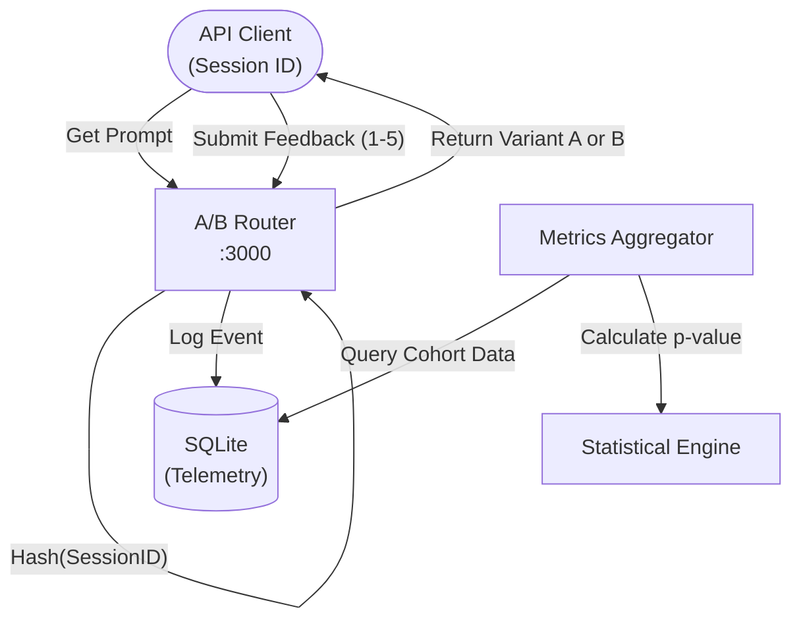

# Architecture — prompt-ab-testing-platform
> Last updated: 2026-08-29 | Maturity: Partial Prototype
> _A/B testing platform for prompt variants with statistical rigor._

## System Diagram

## Component Table
| Component | File | Responsibility | Tech |
|---|---|---|---|
| Router | `src/router.ts` | Assigns cohorts deterministically | Node.js |
| Stats Engine | `src/stats.ts` | Calculates Z-score / T-test | Node.js |
| Storage | `src/db.ts` | Logs assignment and feedback events | SQLite |

## Dependency Honesty Table
| Dependency | Status | Notes |
|---|---|---|
| SQLite | **Real** | Used as a local data warehouse for telemetry. |
| LLM Provider | **Mocked** | Platform assumes prompt injection happens downstream. |

## Component Breakdown
- **Core Technology**: TypeScript, PostgreSQL, SciPy (via Python worker)
- **Design Paradigm**: Emphasizes high availability, fault tolerance, and security.

## Progressive Credential Loading & Production Architecture (v0.2.0)

This service implements the **Progressive Credential Loading (PCL)** pattern, decoupling development speed from external infrastructure provisioning:

### Core Architecture Components
1. **Mode Detection Singleton:** Inspects environment configuration at boot time without hard crashes on missing secrets.
2. **Dual-Mode Factory Wrappers:**
   - **Storage / Cache:** In-process maps or SQLite `:memory:` transparently promote to managed Redis or PostgreSQL when connection strings are supplied.
   - **AI Providers:** Deterministic heuristic generators and local embeddings transparently promote to live OpenAI, Anthropic, or Gemini API clients.
3. **Hot-Reload & Dynamic TLS:** File watchers monitor mounted volume paths (Kubernetes ConfigMaps and Secrets) to update certificates and limit configs atomically without process restarts.
4. **Health & Observability:** The `/health` endpoint exposes real-time runtime mode metadata (`mock` vs `live`) across all backing adapters.
